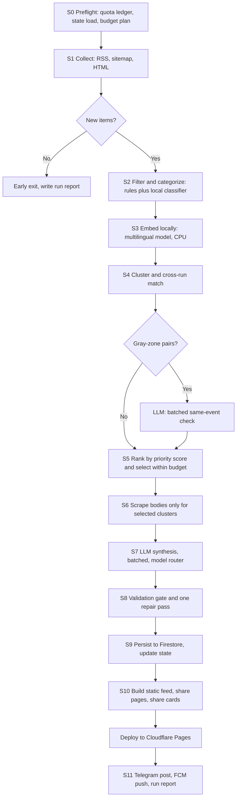

# Dorpon Daily: Free-Tier Redesign, Build Specification (v3)

> **Audience:** the Antigravity build agent.
> **Supersedes:** the pipeline sections of `PIPELINE_ARCHITECTURE.md` v2.0.0. Where this document conflicts with the existing repo, follow this document and record the deviation in `docs/DECISIONS.md`.
> **Existing repo:** `pipeline/` (collectors, processing, storage, `run_pipeline.py`), `dorpon_app/` (Flutter), Firestore project `dorpon-a99a6`, GitHub Actions hourly workflow.

---

## 0. Rules of engagement for the agent

1. Work phase by phase (Section 15). Finish and test one phase before starting the next. Each phase is one reviewable PR.
2. Never call the live Gemini API during development or CI. Use the `LLM_MODE=mock|record|live` switch (Section 5.7). The daily quota is tiny and must be protected.
3. Never invent feed URLs, model IDs or API fields. Verify each against the live service or official docs, and write what you verified into `docs/VERIFIED.md`.
4. Never commit secrets. Secrets live in GitHub Actions secrets and local `.env` (gitignored).
5. When a requirement is ambiguous, pick the simplest option that keeps the pipeline free, and log it in `docs/DECISIONS.md`.
6. Every LLM output is untrusted input. Validate it (Section 8) before it touches Firestore.

---

## 1. Goals and hard constraints

**Product.** A Bangla-first news feed for Bangladeshi readers who get news from social media, especially Gen Z. Each story is readable in about 10 seconds: headline, one-line lead, 3 factual bullets. Everything else is behind a tap.

**Cost.** Recurring cost must be **$0**:

| Need | Free service |
|---|---|
| LLM | Gemini API free tier (AI Studio) |
| Compute | GitHub Actions |
| Database | Firestore Spark plan |
| Feed hosting and share pages | Cloudflare Pages (static; verify current limits) or Firebase Hosting |
| Push notifications | Firebase Cloud Messaging |
| Alerts and review queue | Telegram Bot API |

Do **not** use anything that needs a billing account (for example Cloud Functions, which require the Blaze plan).

**Reliability.** A run must never fail because of a quota error. It degrades instead (Section 5.5).

### 1.1 Gemini free-tier limits (read from the owner's AI Studio console, 2026-10-21)

| Model (console name) | RPM | TPM | RPD | Role |
|---|---|---|---|---|
| Gemini 3.5 Flash Lite | 15 | 250K | **500** | Workhorse for almost everything |
| Gemini 3.6 Flash | 5 | 250K | **20** | Premium pool A (breaking stories) |
| Gemini 3.8 Flash | 5 | 250K | **20** | Premium pool B (overflow, repairs) |

Facts that drive the design:

- **Requests per day are the scarce resource. Tokens are not.** Typical usage is about 10K TPM against a 250K limit. Therefore: **batch many items into one request.**
- The current pipeline already exceeded the 20/day limit on 3.6 Flash (22/20 in the console). It must never be used per-story.
- Limits are per project and can change. Keep them in `config/quota.yaml` and re-read them from the console at project start.
- Daily quotas reset at midnight **Pacific** time. Use `zoneinfo.ZoneInfo("America/Los_Angeles")` for the ledger date.
- Resolve exact model ID strings with `client.models.list()` using the `google-genai` SDK. Put them in config, never in code.
- Safety margins: plan to use at most **70% of RPD** and **60% of RPM** per model.

---

## 2. Design principles

1. **The LLM is scarce.** Use it only for language generation and borderline judgement. Filtering, clustering, ranking, tagging checks, source verification and digests are deterministic or local.
2. **Batch.** One request handles many stories.
3. **Degrade, don't die.** Fallback chain ends with a no-LLM extractive card.
4. **Stateless runner.** All state lives in Firestore. The runner can be killed at any point and the next run recovers.
5. **Idempotent.** Re-running a stage never duplicates stories.
6. **Verify, then publish.** A deterministic gate sits between the LLM and the database.
7. **Observable.** Every run writes a structured report. Silent failure is the worst failure.

---

## 3. Architecture



Key change from v2: **scraping moves after clustering and selection.** Clustering uses only the headline and the RSS description, which cost nothing. Full bodies are fetched only for stories that will actually be synthesized.

---

## 4. Repository layout

```
.github/workflows/
  pipeline.yml        # scheduled hourly (see 12.1)
  digest.yml          # morning and evening digest push
  keepalive.yml       # prevents the 60-day auto-disable
  calibrate.yml       # manual: threshold calibration
config/
  sources.yaml        # feed registry
  quota.yaml          # model limits, safety margins, model IDs
  thresholds.yaml     # clustering thresholds (written by calibration)
  categories.yaml     # taxonomy and seed headlines per category
  sensitive.yaml      # patterns that force review
  banned_phrases.yaml # per-language
  tags.yaml           # controlled tag vocabulary
  scoring.yaml        # priority weights
pipeline/
  run.py              # orchestrator (Section 13)
  budget.py           # quota ledger, allocator, rate limiter
  llm/
    client.py         # wrapper, mock/record/live modes
    router.py         # task-to-model routing and fallback
    schemas.py        # Pydantic models
    prompts.py
  collect/            # rss.py, sitemap.py, html.py, health.py
  process/            # filters.py, categorize.py, embed.py, cluster.py, rank.py
  extract/            # article.py (body scraping)
  validate/           # gate.py, grounding.py, digits.py
  store/              # firestore.py, state.py
  publish/            # snapshot.py, share_pages.py, cards.py, telegram.py, fcm.py
tools/
  calibrate_threshold.py
  replay.py           # replay a saved day of feeds with mocked LLM
  label_pairs.py
eval/
  pairs.jsonl         # labeled same-event pairs (bn, en, mixed)
  fixtures/           # saved feed snapshots and article bodies
tests/
docs/                 # AUDIT.md, DECISIONS.md, VERIFIED.md
```

---

## 5. Quota-aware LLM layer (the heart of the redesign)

### 5.1 Task routing

| Task | Batch size | Primary model | Fallback chain |
|---|---|---|---|
| `adjudicate_pairs` (same event? yes/no) | up to 25 pairs per call | 3.5 Flash Lite | none: treat as "not same", create a related-link |
| `synthesize` for priority tier **breaking** | up to 3 clusters per call | 3.6 Flash | 3.8 Flash, then Lite, then extractive |
| `synthesize` for all other tiers | up to 5 clusters per call | 3.5 Flash Lite | extractive |
| `repair` (failed validation, one retry) | batch the failures together | same pool as the original | extractive |
| Digest text | no LLM | n/a | n/a (headlines of top stories) |

Which Flash model gets the premium role is configurable. Run the Bangla quality eval (Section 14) on all three models and set the routing from the results.

### 5.2 Budget allocator (`pipeline/budget.py`)

- `daily_cap[model] = floor(0.70 * RPD)` gives Lite 350 and each Flash 14.
- At run start, load today's counters from the ledger and compute `runs_left_today` from the cron schedule.
- `run_cap[model] = clamp(ceil(remaining_cap / max(1, runs_left_today)) * 2, 3, 25)` for Lite, and the same formula capped at 4 for Flash models.
- The orchestrator receives a `Budget` object and asks it `budget.can_call(model, n=1)` before every call. After the cap is hit, the remaining work is deferred (Section 9), never forced.
- Expected steady state: 3 to 8 Lite calls and 0 to 2 Flash calls per run. If a run needs more than that, log a warning.

### 5.3 Rate limiter and retries

- One token bucket per model at `0.6 * RPM` (Lite about 9 RPM, Flash about 3 RPM). Sleep as needed. Calls are sequential, not parallel.
- On HTTP 429 or 503: exponential backoff with jitter, max 3 attempts. If the 429 indicates quota exhaustion, mark the model `exhausted` in the ledger for the rest of the day and move down the fallback chain.
- Count **every attempt** against the ledger, including failures.

### 5.4 Quota ledger

- Firestore doc `ops_quota/{YYYY-MM-DD_PT}`: `{ "<model_id>": {"used": int, "exhausted": bool} }`.
- Use `firestore.Increment` before each call so parallel manual runs cannot double-spend.

### 5.5 Fallback and extractive mode

If no LLM budget remains, the pipeline still publishes:

- `ai_status: "extractive"`.
- Headline taken from the lead source (cleaned), lead = the first 1 to 2 sentences of the RSS description or body, truncated to 30 words. No bullets, no impact line.
- These cards are excluded from the "Top" and "Breaking" rails and carry a subtle "summary pending" marker.
- **Backfill:** at the start of each run, select up to 10 extractive stories from the last 24 hours, highest priority first, and put them at the front of the synthesis queue if budget exists.

### 5.6 Calling Gemini

- Use the `google-genai` SDK. Request JSON with `response_mime_type="application/json"` and a `response_schema` generated from the Pydantic models.
- `temperature=0.2`, explicit `max_output_tokens`.
- If the response is truncated or invalid JSON, split the batch in half and retry once. Each retry counts against the budget.
- Truncate inputs: per cluster, at most 1,500 characters of the lead article body plus 800 characters from one alternate source. The first paragraphs of news carry the facts, and shorter input means better Bangla output.

### 5.7 Mock, record and live modes

- `LLM_MODE=mock`: deterministic fake responses, used in unit tests and CI.
- `LLM_MODE=record`: call the live API and store request-hash to response JSON under `eval/llm_cache/`.
- `LLM_MODE=live`: production.
- `replay.py` replays a saved day of feeds against the cache so the agent can iterate on clustering, ranking and validation for free.

---

## 6. Collection and filtering (no LLM)

### 6.1 Source registry (`config/sources.yaml`)

Fields per source: `id, name, lang (bn|en), type (rss|sitemap|html), url, section, authority (0 to 1), max_items (default 12), enabled, html_selectors`.

Candidate sources. **The agent must verify each URL live, disable dead ones, and invent none:**

- Bangla dailies and portals: Prothom Alo, Bangla Tribune, Kaler Kantho, Samakal, Jugantor, Ittefaq, Jagonews24, Dhaka Post, bdnews24.
- English: The Daily Star, The Business Standard, Dhaka Tribune, New Age, Financial Express, BSS, UNB, Prothom Alo English.
- International with Bangla coverage: BBC Bangla, DW Bangla. International: Al Jazeera, TechCrunch.
- Primary sources (high authority, often earlier than media): Bangladesh Bank press releases, NBR, BPSC notices, PMO and Press Wing releases.
- Fact-check and rumor sources (Phase 7): Rumor Scanner, Dismislab, Fact Watch, AFP Fact Check Bangla.

Prefer a news sitemap where an RSS feed is capped, truncated or flaky.

### 6.2 Collector behavior

- Conditional GET with `ETag` and `Last-Modified`; skip unchanged feeds.
- Per-feed cap `max_items` (default 12) so no publisher dominates the pool.
- Identify with an honest User-Agent, honor `robots.txt`, and add small per-host delays.
- **Seen index:** one Firestore doc `state/seen_index` holding a compact set of URL hashes (12 hex chars) from the last 72 hours. One read and one write per run.
- Freshness window is **4 hours** and de-duplication is by the seen index, so a delayed cron run does not lose stories.
- **Early exit:** if no new URLs after the seen-index check, write a short run report and exit in under 30 seconds. Do this before loading the embedding model.
- **Source health** in `state/source_health`: success rate, last error, last new-item time. Auto-disable a feed after 24 consecutive failures and send a Telegram alert.

### 6.3 Filtering and categorization

- Language by script ratio.
- Exclusions (config-driven): astrology, movie reviews, petty crime, and local road accidents unless they pass a severity pattern (for example, high casualty counts).
- **Decision for the owner (default below):** sports and entertainment are **opt-in categories**, not hard exclusions. Bangladeshi Gen Z follows cricket closely. They stay off the Top and Breaking rails by default and appear for users who select them. If the owner wants them dropped entirely, flip `exclude: true` in `config/categories.yaml`.
- **Category classifier (local):** nearest-centroid on embeddings, using about 10 seed headlines per category in both languages (`config/categories.yaml`).
  Taxonomy: `politics, economy, world, tech, education_jobs, health, climate_environment, law_order, national, sports, entertainment`.
- **Sensitivity flag:** `config/sensitive.yaml` regex and keyword patterns in Bangla and English (communal or religious clashes, blasphemy allegations, sexual violence, child victims, sub judice matters). A match sets `sensitivity: high`, which forces review (Section 10).

---

## 7. Embedding, clustering and cross-run memory (local)

### 7.1 Embeddings

- Local multilingual model, CPU only. Start with `intfloat/multilingual-e5-small` (use the `"query: "` prefix) and compare against `LaBSE` on the labeled pairs. **Confirm Bangla pair quality before choosing.** Some popular multilingual models do not cover Bengali well.
- Input text: `headline + ". " + first 200 chars of description`.
- Cache the model directory with `actions/cache`. Use `sentence-transformers`, or `fastembed` (ONNX) if the chosen model is supported and it makes cold starts faster.
- Normalize vectors. Store them as int8-quantized base64 strings (about 384 bytes each) in Firestore.

### 7.2 Thresholds must be calibrated, not guessed

The v2 spec fixes cosine at 0.72. That number is not trustworthy: e5-family models compress similarities into a high band, so unrelated headlines can score 0.7 or more. Build `tools/calibrate_threshold.py`:

1. `tools/label_pairs.py` samples about 200 candidate pairs from saved feeds (bn-bn, en-en, bn-en). One-time labeling may use Lite in batches of 25 (about 8 calls), then the owner spot-checks at least 50 of them. Save to `eval/pairs.jsonl`.
2. Sweep thresholds. Set `T_hi` where precision is at least 0.97, and `T_lo` where recall is at least 0.90. Write both to `config/thresholds.yaml`, plus a separate `T_rel` for related-story links.
3. Re-run calibration whenever the embedding model changes.

### 7.3 Clustering rules

- Single-pass incremental clustering. Each cluster has an immutable **seed** (the highest-authority, earliest article). An article joins a cluster only if its similarity to the **seed** is at least `T_hi`. This prevents snowball merges.
- Additional guards: `|Δt| <= 24h`, compatible category, **max cluster size 8**, one source per domain.
- **Gray zone** (`T_lo <= sim < T_hi`): queue the pair for the batched same-event LLM check. If budget is gone, default to **not merged**, and add a related-story link instead. When unsure, do not merge.
- Verify clusters after formation. If any member's similarity to the seed falls under `T_lo`, evict it.

### 7.4 Cross-run memory

- Firestore doc `state/recent_index` keeps the last 48 hours: `{story_id, seed_vec_b64, headline, category, first_seen, last_updated, source_domains[]}`. One read and one write per run, and no scanning of story docs.
- A new cluster whose seed matches a recent story (above `T_hi`, within 24 hours) **enriches** that story with no LLM call. Add the source only if its domain is new and the story has fewer than 4 sources.
- Related stories (`T_rel <= sim < T_lo`, or same category with shared entity tokens) are computed locally, max 3 per story. Related items never enter `sources`.
- **Developing stories (Phase 5 optional):** if a story gains 2 or more new domains within 6 hours and premium budget remains, re-synthesize once and increment `version`.

---

## 8. Ranking and selection

```
priority = 100 * (0.35*coverage + 0.20*authority + 0.20*impact + 0.15*recency + 0.10*category_boost)
coverage       = min(unique_domains, 4) / 4
authority      = max source authority in cluster
impact         = 1.0 if money, casualty, policy-notice or exam-result patterns match, 0.5 if partial, else 0
recency        = exp(-age_hours / 12)
category_boost = from config/scoring.yaml
```

Tiers (thresholds in config): **breaking** (priority at least 75, age at most 3 hours, and either 2 or more domains or one high-authority primary source), **top** (at least 55), **standard**, **low**.

Selection: sort by priority, send breaking to the premium pool within its cap, send the rest to Lite within its cap. Anything that does not fit becomes `status: pending` and is retried for 12 hours. After that it becomes extractive.

Target: roughly 60 to 80 new cards per day, with the feed UI showing the top 30 by default.

---

## 9. Synthesis

### 9.1 Output schema (Pydantic, one object per cluster)

```json
{
  "cluster_id": "string",
  "category": "enum",
  "headline_bn": "<= 14 words, declarative, no question",
  "headline_en": "<= 14 words",
  "lead_bn": "<= 25 words, who did what",
  "lead_en": "<= 25 words",
  "bullets_bn": ["3 items, each <= 22 words"],
  "bullets_en": ["3 items"],
  "bullet_evidence": ["3 verbatim snippets (<= 20 words) copied from the source text, one per bullet"],
  "impact_bn": "string or null, <= 20 words",
  "impact_en": "string or null",
  "details_bn": "<= 90 words, for the Read more section",
  "details_en": "<= 90 words",
  "disagreement_note_bn": "string or null, only if sources contradict each other",
  "disagreement_note_en": "string or null",
  "event_date": "ISO date or null",
  "tags": ["2 to 4 items"],
  "single_source_allegation": true
}
```

Both languages are generated in the same request. Tokens are cheap under this quota, and requests are not.

### 9.2 Prompt requirements (system instruction)

- Role: wire-service editor writing for 18 to 30 year-old Bangladeshi readers. Plain, direct, no hype.
- Inverted pyramid. The lead answers who did what, where. Each bullet must add a **new** fact. No bullet may repeat the lead.
  - Bullet 1: the core action or decision.
  - Bullet 2: the key number, amount, date or direct quote.
  - Bullet 3: the next step, deadline or concrete consequence, **only if stated in the source**. Otherwise use another stated fact. Never write interpretation.
- `impact_*`: fill only when the source supports a concrete effect on ordinary people (prices, jobs, exams, transport, services). Otherwise `null`. Never write "this highlights" or "this shows".
- Attribution: allegations, claims and unverified statements must be attributed ("police said", "according to the ministry"). Never state an allegation as fact. If only one unnamed source supports the story, set `single_source_allegation: true`.
- If sources disagree on a material fact, fill `disagreement_note_*` neutrally and name the outlets.
- Do not use relative day words (today, yesterday, weekday names). Use absolute dates, or leave the date out.
- No speculation, no adjectives of judgement, no clickbait, no questions.
- Every number, name and date must come from the provided text. Never add outside knowledge.
- Tags: 2 to 4, chosen from `config/tags.yaml` or named entities that appear in the provided text. A tag about a topic not in the text is forbidden.
- Bangla style: standard written Bangla (চলিত ভাষা), short sentences, no word-for-word calques from English. Proper nouns follow common Bangladeshi newspaper spelling.
- Include one worked example (English plus a Bangla headline and lead) labeled `EXAMPLE ONLY, DO NOT REUSE FACTS`.

### 9.3 Post-processing (code, not LLM)

- `digits.py`: normalize digits per field (Bangla digits in `*_bn`, ASCII in `*_en`). Do not trust the model for this.
- Strip markdown and stray quotes, collapse whitespace.

---

## 10. Validation gate (`pipeline/validate/gate.py`)

Run on every synthesized item. Each failure has a stable error code.

| Code | Check |
|---|---|
| `SCHEMA` | Valid against Pydantic model, all required fields present |
| `LEN` | Word and character limits from 9.1 |
| `LANG` | `*_bn` fields at least 70% Bengali-script characters, `*_en` fields at least 90% Latin/ASCII letters |
| `BANNED` | Phrases from `config/banned_phrases.yaml`. Seed English: "underscores", "signals", "highlights", "amid", "sparks", "shocking". Seed Bangla: "প্রতীয়মান হয়", "ইঙ্গিত দিচ্ছে" |
| `QUESTION` | No question marks in headlines |
| `NUM_GROUND` | Every number in the output (after digit normalization) appears in the source text |
| `NAME_GROUND` | Capitalized English tokens appear in source. For Bangla, at least 80% of content tokens of headline and lead are found in source text |
| `EVIDENCE` | Each `bullet_evidence` snippet occurs in the source text (whitespace-normalized, fuzzy ratio at least 0.9) |
| `TAG_GROUND` | Every tag is in the controlled list or appears in the source text. This kills tag leakage across topics |
| `REDUNDANT` | Bullet versus lead token overlap above 0.8 |
| `DATE_REL` | No relative day words |
| `SENSITIVE` | `sensitivity: high` forces `held_review` regardless of other results |

Outcomes:

- All pass → `published`.
- Failures → one **repair pass** with the error codes appended, batched together with other failures. Repair counts against the budget.
- Still failing → `extractive` (Section 5.5). If it also fails basic checks → `rejected`, logged.
- `SENSITIVE` → `held_review`. Send a Telegram message with the card preview and inline Approve and Reject buttons. At the start of every run, poll `getUpdates` for button presses and apply them. Approval latency is at most the cron interval, and no extra infrastructure is needed.
- `single_source_allegation: true` → publish only if tier is not `breaking`, and show a visible "single source" label.

---

## 11. Persistence, state and publishing

### 11.1 Firestore model (replaces `daily_buzz` and `hourly_buzz`)

- `stories/{story_id}`: one document per story. `story_id = uuid5(NAMESPACE_URL, seed_url)`, **immutable**. Fields: all synthesis fields, `status` (`published|extractive|pending|held_review|rejected`), `tier`, `priority`, `category`, `sources[]` (name, url, title, published_at; max 4; one per domain), `related[]` (story_id and titles), `version`, `published_at`, `updated_at`, `expire_at`.
- `state/seen_index`, `state/recent_index`, `state/source_health`.
- `ops_runs/{run_id}`: per-stage counts, LLM calls per model, durations, errors, warnings.
- `ops_quota/{date}`: ledger (Section 5.4).
- Enable a Firestore **TTL policy** on `expire_at` (30 days).
- **Security rules:** client apps get read-only access to `stories` (archive pagination only). All writes come from the service account.
- Spark plan sanity check (verify current numbers): pipeline needs roughly 900 writes and 500 reads per day. The daily quota has plenty of room.

### 11.2 Static feed for clients

The Flutter app must **not** query Firestore for the main feed. A direct read per app open would burn the free read quota quickly.

- After persisting, build `feed.json` (top 80 published stories, full bilingual content, about 3 KB each) and `feed.meta.json` (`{version, generated_at, count}`, tiny, used for cheap polling).
- Deploy to Cloudflare Pages with direct upload from Actions (`wrangler pages deploy`). Fallback: Firebase Hosting. Verify bandwidth terms before relying on either.
- The app polls `feed.meta.json`, fetches `feed.json` only on a version change, and caches it locally. Firestore is used only for archive pagination.

### 11.3 Share pages and cards (this is how social sharing works for free)

- Cloud Functions are not allowed (billing). Instead the pipeline **pre-renders a static HTML page per story**: `/s/{story_id}/index.html`. It carries Open Graph and Twitter tags (title, description, image) so Messenger, WhatsApp and Facebook show a proper preview, and it links into the app or web feed. Keep the last 7 days of pages.
- **Share card image:** 1080x1350 PNG with headline and 3 bullets. Render from an HTML template with Playwright/Chromium. This is more reliable than Pillow for Bengali conjunct shaping. If Pillow is used, `libraqm` is required and must be verified with a rendering test. Generate cards only for `top` and `breaking` stories. Use the Noto Sans Bengali or Hind Siliguri font.
- **No publisher images in v1.** Do not copy or host publisher photos. Use the generated card as the image. Add `use_publisher_images: false` to config and leave the code path disabled, so the owner can decide later after legal advice.

### 11.4 Notifications and distribution

- **FCM topics:** `breaking`, `digest_morning`, `digest_evening`, `cat_<category>`. Throttle breaking pushes to 3 per day, with a minimum 90-minute gap.
- **Digest** (no LLM): `digest.yml` selects the top 5 stories by priority and pushes their headlines. Run at about 08:00 and 21:00 Bangladesh time.
- **Telegram channel** auto-post for `top` and `breaking` (card image, headline, link to the share page).
- Facebook Page auto-post is optional (Phase 7) and needs Graph API setup. WhatsApp channels have no posting API, so that stays manual.

---

## 12. GitHub Actions

### 12.1 `pipeline.yml`

```yaml
name: pipeline
on:
  schedule:
    - cron: "7 0-17 * * *"    # hourly, 06:07-23:07 Bangladesh time
    - cron: "7 19,22 * * *"   # two night runs, 01:07 and 04:07 Bangladesh time
  workflow_dispatch:
    inputs:
      dry_run: { type: boolean, default: false }
      max_llm_calls: { type: string, default: "" }
concurrency:
  group: dorpon-pipeline
  cancel-in-progress: false
jobs:
  run:
    runs-on: ubuntu-latest
    timeout-minutes: 12
    steps:
      - uses: actions/checkout@v4
      - uses: actions/setup-python@v5
        with: { python-version: "3.12", cache: pip }
      - uses: actions/cache@v4
        with:
          path: ~/.cache/huggingface
          key: embed-${{ hashFiles('config/quota.yaml') }}-v1
      - run: pip install -r requirements.txt
      - run: python -m pipeline.run
        env:
          LLM_MODE: live
          GEMINI_API_KEY: ${{ secrets.GEMINI_API_KEY }}
          FIREBASE_SA_B64: ${{ secrets.FIREBASE_SA_B64 }}
          TELEGRAM_BOT_TOKEN: ${{ secrets.TELEGRAM_BOT_TOKEN }}
          TELEGRAM_CHAT_ID: ${{ secrets.TELEGRAM_CHAT_ID }}
          DRY_RUN: ${{ inputs.dry_run }}
      - name: Deploy static site
        if: success()
        run: npx wrangler pages deploy dist --project-name dorpon
        env:
          CLOUDFLARE_API_TOKEN: ${{ secrets.CLOUDFLARE_API_TOKEN }}
          CLOUDFLARE_ACCOUNT_ID: ${{ secrets.CLOUDFLARE_ACCOUNT_ID }}
      - name: Alert on failure
        if: failure()
        run: >
          curl -s "https://api.telegram.org/bot${{ secrets.TELEGRAM_BOT_TOKEN }}/sendMessage"
          -d chat_id=${{ secrets.TELEGRAM_CHAT_ID }}
          -d text="Dorpon pipeline failed: ${{ github.run_id }}"
```

Notes for the agent:

- Scheduled runs often start 10 to 60 minutes late and may be skipped under load. The design tolerates this (4-hour window plus seen index). Never depend on exact timing.
- Minute budget on a **private** repo: about 20 runs per day at an average of 2.5 minutes is 1,500 minutes per month, under the 2,000 free minutes. The early-exit path matters here. On a public repo it is not a concern.
- Scheduled workflows in public repos are disabled after 60 days of repo inactivity. `keepalive.yml` runs weekly and calls the REST endpoint that enables the pipeline workflow so the timer resets. Verify this works and note it in `docs/VERIFIED.md`.

### 12.2 `digest.yml`

Crons at 02:05 and 15:05 UTC (08:05 and 21:05 Bangladesh time). Runs `python -m pipeline.digest`. No LLM calls.

---

## 13. Orchestrator (`pipeline/run.py`) reference flow

```python
def run(cfg):
    report = RunReport.start()
    ledger = QuotaLedger.load(pt_today())
    budget = Budget.plan(cfg.quota, ledger, runs_left_today())
    state  = State.load()                          # seen_index, recent_index, source_health
    review.apply_pending_decisions()               # Telegram approve/reject
    items = collect(cfg.sources, state)
    if not items.new:
        return report.finish(early_exit=True)
    items = categorize(filter_items(items))
    vecs = embed(items)
    clusters, gray_pairs = cluster(items, vecs, state.recent_index, cfg.thresholds)
    decisions = llm.adjudicate(gray_pairs, budget)  # falls back to "not merged"
    clusters = apply_decisions(clusters, decisions)
    enrich, fresh = split_cross_run(clusters, state.recent_index)
    enrich_existing(enrich)                         # no LLM
    queue = backfill_extractive() + rank(fresh)
    to_synth, deferred = budget.select(queue)
    bodies = extract_bodies(to_synth)               # timeouts, RSS fallback
    results = synthesize(to_synth, bodies, budget)  # router, batching, splits
    final = validate_and_repair(results, budget)
    final += as_extractive(deferred_or_failed(final, deferred))
    persist(final); state.save()
    build_static_site(final); render_cards(final)
    notify(final); report.finish(budget=budget)
```

Every stage must catch its own exceptions, record them in the report, and let later stages proceed on partial data. A failure in sharing or notification must never block persistence.

---

## 14. Testing and evaluation

- **Unit tests:** every validator code in Section 10, digit normalization, ledger arithmetic, budget allocator, rate limiter (with a fake clock), source health logic.
- **Fixtures:** 40 saved clusters (Bangla, English, mixed) with source text, plus the known failure cases from v2: 22 unrelated police items merged into a political rally, Bangladesh cricket tags on a US-Israel diplomatic story, publisher over-indexing.
- **Replay test:** `tools/replay.py` runs a full day of saved feeds through every stage with the mock LLM and asserts invariants (no cluster above 8 sources, no domain twice in `sources`, no ungrounded tag).
- **Bangla quality eval:** `eval/bangla_quality/` has 30 source articles. Run all three models (record mode, a small number of calls), and score with the validator plus a human review sheet for the owner. Use the result to set the routing table.

**Acceptance criteria**

| Metric | Target |
|---|---|
| Cluster precision on `eval/pairs.jsonl` | at least 0.97 |
| Cross-category tag leakage in 200 synthesized cards | 0 |
| Validation failure rate before repair | below 15% |
| Average LLM calls per run | at most 8 |
| Lite calls per day | at most 350 |
| Each Flash model per day | at most 14 |
| Runs failing because of quota errors | 0 (they degrade) |
| Median run time (with new items) | at most 4 minutes |
| Early-exit run time | at most 45 seconds |

---

## 15. Phased task list

**Phase 0: Audit and foundations.**
Read the existing repo and write `docs/AUDIT.md` (what is kept, replaced, deleted). Add the config files, the `LLM_MODE` client, quota ledger, allocator and rate limiter with tests. Resolve the model IDs and record them in `docs/VERIFIED.md`.

**Phase 1: Collection, state and the workflow.**
Source registry, conditional GET, per-feed quotas, seen index, health tracking, early exit, filters, categorizer, run reports, new `pipeline.yml` with concurrency, timeouts and failure alerts, `keepalive.yml`. No LLM yet.

**Phase 2: Clustering.**
Local embeddings, label tooling, calibration, incremental clustering with guards, cross-run `recent_index`, related-story links, priority score and tiers. Deliver the replay test.

**Phase 3: Synthesis and validation.**
Prompts and schemas, router with fallback, batching and split-on-failure, validator, repair pass, extractive fallback and backfill. Run the Bangla quality eval and set the routing.

**Phase 4: Persistence and publishing.**
Single `stories` collection, migration script from `daily_buzz` and `hourly_buzz`, Firestore rules, TTL, `feed.json` and `feed.meta.json`, static deploy, pre-rendered share pages.

**Phase 5: Distribution.**
Share-card renderer, Telegram channel posting, FCM topics and throttling, `digest.yml`, optional developing-story re-synthesis.

**Phase 6: Flutter client.**
- Feed loads from `feed.meta.json` and `feed.json` with local cache. Firestore only for archive.
- Card shows headline, lead, 3 bullets, optional impact chip. "Read more" expands details, sources, related stories and tags.
- Bangla is the default language, with an English toggle. Interest picker on first launch, stored locally, mapped to FCM topics.
- Badges: "single source", "summary pending" for extractive cards. Never show `held_review` or `rejected`.
- Share button shares the static share-page URL.

**Phase 7: Trust and coverage.**
Sensitive-topic review queue via Telegram, fact-check sources and a "viral claim" card type, primary government sources, optional Facebook page posting.

---

## 16. Open decisions and risks (owner to confirm)

1. **Sports and entertainment:** opt-in categories (default in this spec) or fully excluded.
2. **Publisher images:** disabled in v1. Revisit after legal advice. Copying and re-hosting images is the highest-risk item.
3. **Scraping and summarizing:** respect `robots.txt` and each site's terms, summarize facts rather than wording, and always link back. Have a lawyer review before public launch, including Bangladesh's rules on publishing and platform liability.
4. **Free-tier terms and limits change.** Re-check them periodically. On the free tier, submitted content may be used by Google to improve its products, so never send private user data to the API. Only public news text goes in.
5. **Free hosting terms:** confirm current Cloudflare Pages (or Firebase Hosting) limits before launch.
6. **Model quality for Bangla** is unverified for the three listed models until the Phase 3 eval is done.
