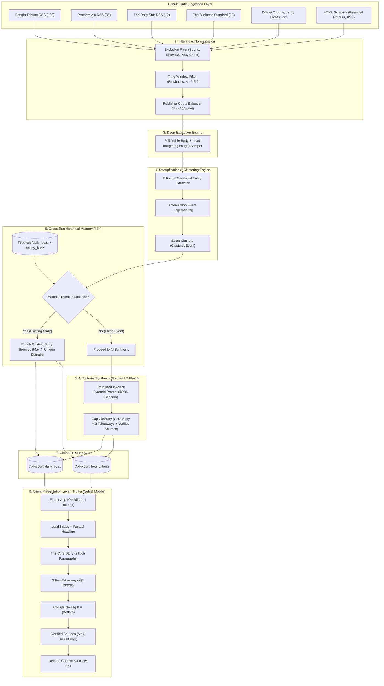

# Dorpon Daily: End-to-End Pipeline & System Architecture Specification

> **Document Version:** 2.0.0  
> **Target Audience:** Principal Systems Architects, Lead Data Engineers, AI/ML Engineers  
> **Status:** Active / Under Architectural Review  
> **Repository:** `Dorpon Daily` (`dorpon-a99a6`)

---

## 1. Executive Summary & Product Vision

**Dorpon Daily** (দর্পণ) is an autonomous, AI-native, bilingual (English & বাংলা) news aggregation, verification, and analytical synthesis platform. The system ingests raw journalistic dispatches from 10+ major national and international media houses, clusters coverage across languages into canonical real-world events, and generates 60-second executive analytical capsules for general readers, policy researchers, and civil service aspirants.

### Core Value Propositions
1. **Single-Card Event Deduplication**: A breaking news story is covered once. Multiple newspapers reporting the same physical event are unified into a single card with multi-outlet citation badges.
2. **Zero-Clickbait Factual Synthesis**: Lengthy, sensationalized, or speculative articles are distilled into an inverted-pyramid news lead paired with structured, factual takeaways.
3. **Bilingual Parity**: Every story card, takeaway, and tag is synthesized in parallel across standard formal Bengali and clean professional English with instant client-side toggling.
4. **Serverless Autonomous Architecture**: The ingestion, clustering, and AI synthesis pipelines execute entirely via GitHub Actions cron runners and serverless Cloud Firestore, requiring \$0 fixed server compute costs.

---

## 2. High-Level System Architecture

The following diagram illustrates the lifecycle of a news item from external publisher ingestion to end-user rendering:



---

## 3. Step-by-Step Pipeline Mechanics: How We Do What

### Stage 1: Candidate Ingestion (`pipeline/collectors/rss_fetcher.py`)
- **RSS Parsing**: Runs via `feedparser`. Gathers raw XML feeds from configured media outlets across politics, national news, business, and tech.
- **Section Scraping**: For outlets whose RSS feeds are capped, broken, or truncated (e.g. *The Financial Express*, *BSS News*), an HTML scraper pulls direct headlines and article links via `requests` and `BeautifulSoup4`.
- **Exclusion Filters (`EXCLUSION_KEYWORDS`)**: Strictly drops tabloid gossip, movie reviews, sports matches, astrology/horoscopes, and local road accidents.
- **Timestamp Parsing**: All timestamps (`published_parsed`, `pubDate`) are converted into timezone-aware UTC ISO 8601 strings.

### Stage 2: Lead Scraping & Image Extraction (`pipeline/collectors/article_scraper.py`)
- For candidate articles prioritized for cluster leadership, the engine visits the target URL with desktop user-agent headers.
- Extracts clean body text by pruning navigation bars, ads, footers, and comment sections.
- Extracts high-resolution lead images via `meta[property="og:image"]` and `meta[property="twitter:image"]`, along with captions.

### Stage 3: Event Clustering (`pipeline/processing/deduplicator.py`)
- **Canonical Entity Dictionary (`CANONICAL_ENTITIES`)**: Maps cross-lingual synonyms to singular slugs (e.g. `{"tarique_visit": ["tarique", "তারেক রহমান", "japan", "জাপান", "tokyo", "টোকিও"]}`).
- **Seed Article Anchoring**: When a cluster is initiated, its entity fingerprint is locked to the seed article to prevent "snowballing" (where article A merges with B, and B merges with C, pulling completely unrelated articles into a runaway cluster).
- **BCS & Academic Scoring**: Computes an academic relevance score ($0.0 \text{ to } 10.0$) using constitutional, fiscal, judicial, and geopolitical keyword weights.

### Stage 4: Cross-Run Historical Memory & Source Enrichment (`pipeline/run_pipeline.py`)
- **The Problem It Solves**: Ingestion runs every 60 minutes. Different newsrooms report major events with a 30–90 minute delay. Without cross-run memory, run 1 creates a card from *Prothom Alo*, and run 2 creates a duplicate card from *Bangla Tribune*.
- **The Mechanism**:
  1. The pipeline queries the past 48 hours of published documents from Firestore (`daily_buzz` and `hourly_buzz`).
  2. Each incoming cluster is checked against the historical corpus using entity signatures and clean token intersection.
  3. **If Matched**: It skips the Gemini LLM API call completely. Instead, it extracts the new publisher citation and calls `enrich_story_in_firestore()`, appending the new publication to the existing story's source list.
  4. **If Unmatched**: The story is verified as genuinely fresh news and forwarded to Gemini for synthesis.

### Stage 5: AI Editorial Synthesis (`pipeline/processing/synthesizer.py`)
- **Model**: Google Gemini 2.5 Pro / Flash.
- **Input Payload**: Primary cluster headline, clean scraped body text, publisher source citations, and category tags.
- **Enforced Output**: Strict Pydantic JSON schema containing:
  - `title_en` / `title_bn`: Factual, active-voice headlines.
  - `summary_en` / `summary_bn`: Inverted pyramid news lead.
  - `key_takeaways_en` / `key_takeaways_bn`: Exactly 3 concrete, factual takeaway points.
  - `tags`: 3–4 strictly verified tags.

### Stage 6: Database Persistence (`pipeline/storage/firebase_service.py`)
- Connects to Google Cloud Firestore using a service account JSON certificate.
- Story IDs are generated deterministically using UUIDv5 hashed against the canonical story URL/lead title (`uuid.uuid5(uuid.NAMESPACE_URL, lead_url)`), ensuring idempotent batch updates.
- Updates both `daily_buzz` (comprehensive archive) and `hourly_buzz` (latest breaking stream).

### Stage 7: Client Presentation Layer (`dorpon_app/`)
- Built in Flutter 3.x using the **Obsidian UI Design Tokens** (dark glassmorphism, `#0B0F17` canvas, `#00E599` mint accent).
- Global bilingual state controller (`AppSettingsService`) allowing seamless on-the-fly toggling between English and বাংলা (`Hind Siliguri` font) with zero layout shift.

---

## 4. Architectural Bottlenecks & Observed Failures (Root Cause Analysis)

Recent production testing highlighted 5 critical edge cases that require rigorous architectural mitigation:

```
┌────────────────────────────────────────────────────────────────────────┐
│                        OBSERVED FAILURE MODES                          │
├────────────────────────────────┬───────────────────────────────────────┤
│ 1. Black Hole Clusters         │ 22 unrelated Daily Star police        │
│    (Runaway Token Merging)     │ blotter items merged into a single    │
│                                │ Jamaat May Day worker rally card.     │
├────────────────────────────────┼───────────────────────────────────────┤
│ 2. Cross-Category Tag Leakage  │ A Pete Hegseth & Netanyahu meeting in │
│                                │ Israel was tagged with #TamimIqbal,   │
│                                │ #BangladeshCricket, and #BCB.         │
├────────────────────────────────┼───────────────────────────────────────┤
│ 3. Publisher Over-Indexing     │ Bangla Tribune supplied 100 RSS items │
│                                │ while Daily Star had 10, flooding the │
│                                │ candidate pool and dominating stories.│
├────────────────────────────────┼───────────────────────────────────────┤
│ 4. Superficial Core Story      │ Over-aggressive 50-word limits cut    │
│                                │ out crucial delegate names, dates,    │
│                                │ and official statements.              │
├────────────────────────────────┼───────────────────────────────────────┤
│ 5. Abstract "Why It Matters"   │ Produced single vague sentences       │
│                                │ ("This highlights governance") rather │
│                                │ than factual news takeaways.          │
└────────────────────────────────┴───────────────────────────────────────┘
```

### Detailed Failure Analysis:

#### Failure A: Conflating "Topic / Subject" with "Physical Event"
* **The Flaw**: The previous deduplication logic counted common token intersections (`len(tokens_a & tokens_b) >= 3`).
* **Why It Failed**: In Bengali political journalism, dozens of distinct stories share common words like *সমাবেশ* (rally), *বলেন* (said), *ঢাকা* (Dhaka), *সরকার* (government). Because these words intersected, a speech by Rashed Khan attacking the Awami League was merged as a "source" of a Jamaat rally in Dhaka, and police reports from Daily Star Crime were piled on top.
* **The Rule**: A shared keyword or topic does **NOT** equal the same event. An event is an immutable physical occurrence bounded by **Actor + Action + Location + Time**.

#### Failure B: Unbounded Set Union of Tags
* **The Flaw**: Every time an article was enriched, the pipeline executed `tags = existing.tags | new.tags`.
* **Why It Failed**: If a single false merge occurred, the card inherited tags from completely unrelated topics (sports, education, crime). Pete Hegseth's Israel trip inherited cricket tags because an earlier cluster had absorbed sports items before strict exclusion.
* **The Rule**: Tags must be synthesized strictly by the AI from the *verified headline and body*, capped at 3–4 items, and never unioned with raw unvetted candidate metadata.

#### Failure C: Publisher RSS Imbalance
* **The Flaw**: `pipeline/collectors/rss_fetcher.py` looped over RSS feeds without rate-limiting entries per publisher.
* **Why It Failed**: Bangla Tribune's feed provides 100 items; Daily Star provides only 10. Consequently, 60% of all candidate articles were from a single media house, skewing topic diversity and clustering frequency.
* **The Rule**: Every publisher feed must be subject to an intake quota (max 12–15 items per crawl).

---

## 5. Production-Grade Target Architecture

To eliminate these issues, the system is re-architected around the following foundational specifications:

### Spec 1: The Event Fingerprint Model ($E$)
Two articles $A_1$ and $A_2$ represent the **exact same event** if and only if they satisfy the 4-tuple equality:

$$\text{SameEvent}(A_1, A_2) \iff \langle \text{Actor}(A_1) = \text{Actor}(A_2) \rangle \land \langle \text{Action}(A_1) \sim \text{Action}(A_2) \rangle \land \langle |\Delta t| \le 24\text{h} \rangle$$

* **Actor**: The primary entity (e.g., `Tarique Rahman`, `Dr. Muhammad Yunus`, `Pete Hegseth`, `Bangladesh Bank`).
* **Action / Predicate**: The physical transaction or announcement (e.g., `Signs MoUs in Tokyo`, `Hikes Repo Rate`, `Resigns from Advisory Post`).
* **Semantic Cosine Threshold**: The headline cosine similarity between the candidate article and the canonical story must exceed **0.72**.

#### Distinction Between "Source" and "Related News":
* **Source (মূল সংবাদ সূত্র)**: A journalistic report from an independent newspaper on the **exact same event tuple** $E$.
  - *Example*: *The Daily Star* and *Prothom Alo* both reporting on Prime Minister Tarique Rahman signing MoUs in Tokyo.
* **Related News (সম্পর্কিত খবর)**: An article sharing thematic, topical, or actor relevance, but representing a **different event tuple**.
  - *Example*: A statement by Rashed Khan discussing the political implications of BNP-Jamaat relations. This belongs in a `related_stories` link, **never** in the `sources` list.

---

### Spec 2: The Four Golden Rules of Sources (`sources`)
1. **Domain Uniqueness (1 Citation per Publisher)**: A story can cite *The Daily Star* at most once. Subsequent articles from the same media house are ignored.
2. **Hard Citation Cap**: A news card must display **at least 1 and at most 4** verified citations (e.g., 1 English Daily, 1 Bengali Daily, 1 Wire Service, 1 Specialized Financial Outlet).
3. **Mandatory Metadata**: Every source object must include:
   ```json
   {
     "name": "The Business Standard",
     "url": "https://www.tbsnews.net/bangladesh/...",
     "title": "PM to sign multiple MoUs during 4-day Tokyo visit",
     "published_at": "2026-10-20T14:30:00Z"
   }
   ```
   No generic placeholders (*"Primary editorial dispatch"*) are permitted.
4. **Headline Semantic Verification**: Before adding a source, the candidate headline is validated against the story's core predicate. If it discusses crime, accidents, or unrelated topics, it is rejected.

---

### Spec 3: Intake Quota Balancing
In `pipeline/collectors/rss_fetcher.py`, ingestion is balanced dynamically:

```python
MAX_CANDIDATES_PER_FEED = 12

for feed_meta in FEEDS.values():
    feed_entries = parse_feed(feed_meta)
    clean_entries = filter_exclusions_and_age(feed_entries)
    # Enforce publisher fairness
    candidates.extend(clean_entries[:MAX_CANDIDATES_PER_FEED])
```

This guarantees that *Daily Star*, *Prothom Alo*, *The Business Standard*, *Dhaka Tribune*, and *Bangla Tribune* enter the clustering phase with equal weight.

---

### Spec 4: Editorial Synthesis Standard V2 (Gemini Prompting)

#### 1. Core Story (100–140 words, 2 Paragraphs)
* **Paragraph 1 (The Lead)**: Who did what, where, when, and the official executive/administrative decision.
* **Paragraph 2 (Crucial Context)**: Key figures, monetary amounts, statutory references, official quotes, or immediate institutional responses.
* **Zero-Clickbait Mandate**: Headlines must be strictly declarative facts. Curiosity-gap or question headlines are prohibited.

#### 2. Key Takeaways (৩টি মূল বিষয়সমূহ)
Replaces the single vague *"Why It Matters"* sentence with **exactly 3 crisp, bulleted facts**:
* **Bullet 1 — The Core Action**: The central event or executive order.
* **Bullet 2 — Crucial Data or Direct Quote**: The key metric (percentage, currency, headcount) or notable statement.
* **Bullet 3 — Next Step / Consequence**: The immediate operational timeline or policy effect.

---

### Spec 5: Client UI Tag Re-Architecture

```
┌─────────────────────────────────────────────────────────┐
│ [← Back]           [EN | বাং]        [🎧] [🔖] [↗]      │
├─────────────────────────────────────────────────────────┤
│ [⚡ Governance & Law]  [⏱ 2 min read]  [✓ Verified]       │
│                                                         │
│ ইসরায়েল সফরকালে নেতানিয়াহুর সঙ্গে মার্কিন                 │
│ প্রতিরক্ষামন্ত্রী পিট হেগসেথের অঘোষিত বৈঠক                  │
│                                                         │
│ ┌─────────────────────────────────────────────────────┐ │
│ │ 📰 The Core Story (2 Rich Paragraphs)               │ │
│ │ ইসরায়েলে আসন্ন পার্লামেন্ট নির্বাচনের প্রাক্কালে...        │ │
│ └─────────────────────────────────────────────────────┘ │
│                                                         │
│ ┌─────────────────────────────────────────────────────┐ │
│ │ 💡 Key Takeaways / মূল বিষয়সমূহ (3 Bullets)         │ │
│ │ • Bullet 1: Factual Core Action                     │ │
│ │ • Bullet 2: Essential Numbers / Official Quote      │ │
│ │ • Bullet 3: Immediate Next Step / Policy Impact     │ │
│ └─────────────────────────────────────────────────────┘ │
│                                                         │
│ 🏷 Tags: [#PeteHegseth] [#USIsrael] [+2 more ▼]         │
│                                                         │
│ ┌─────────────────────────────────────────────────────┐ │
│ │ 📖 Verified Sources (2-4 accredited media outlets)  │ │
│ │ [Prothom Alo] [The Daily Star] [Axios]              │ │
│ └─────────────────────────────────────────────────────┘ │
│                                                         │
│ ┌─────────────────────────────────────────────────────┐ │
│ │ 🔗 Related Context & Background (সম্পর্কিত সংবাদ)     │ │
│ │ • Netanyahu meets US Secretary of State             │ │
│ └─────────────────────────────────────────────────────┘ │
└─────────────────────────────────────────────────────────┘
```

1. **Relocation**: Tags are moved from the top of the screen to the **bottom** (below Key Takeaways).
2. **Default Collapsed State**: Maximum **2 or 3 primary tags** shown by default.
3. **Interactive Toggle**: A `+N more` pill dynamically unfolds remaining tags on tap without shifting the reading flow.

---

## 6. Target Data Contracts & Schemas

### `CapsuleStory` (Firestore Document Schema)
```json
{
  "story_id": "top-story-hegseth-israel-visit-2026",
  "primary_category": "world_diplomacy",
  "interest_categories": ["world_diplomacy", "governance_law"],
  "tags": ["#PeteHegseth", "#USIsraelRelations", "#MiddleEastGeopolitics"],
  "image_url": "https://images.dorpon.net/2026/10/hegseth-netanyahu.jpg",
  "image_caption": "US Defense Secretary Pete Hegseth meeting with Benjamin Netanyahu in Tel Aviv.",
  "published_at": "2026-10-21T01:02:00Z",
  "is_bcs_pro_selected": false,
  "sources": [
    {
      "name": "The Daily Star",
      "url": "https://www.thedailystar.net/news/world/hegseth-israel-visit",
      "title": "US Defense Secretary Hegseth holds unannounced talks with Netanyahu",
      "published_at": "2026-10-21T00:45:00Z"
    },
    {
      "name": "Prothom Alo",
      "url": "https://www.prothomalo.com/world/hegseth-israel",
      "title": "নেতানিয়াহুর সঙ্গে মার্কিন প্রতিরক্ষামন্ত্রী পিট হেগসেথের বৈঠক",
      "published_at": "2026-10-21T01:00:00Z"
    }
  ],
  "daily_buzz": {
    "title_en": "US Defense Secretary Pete Hegseth Holds Unannounced Talks with Netanyahu in Israel",
    "title_bn": "ইসরায়েল সফরে নেতানিয়াহুর সঙ্গে মার্কিন প্রতিরক্ষামন্ত্রী পিট হেগসেথের অঘোষিত বৈঠক",
    "summary_en": "United States Defense Secretary Pete Hegseth arrived in Tel Aviv on Monday for an unannounced diplomatic mission ahead of Israel's upcoming parliamentary elections. Hegseth held bilateral consultations with Prime Minister Benjamin Netanyahu without prior public notification, focusing on regional deterrence and maritime security in the Red Sea.\n\nAccording to official diplomatic readouts, the discussions addressed missile defense integration and ongoing ceasefire protocols across southern Lebanon. The meeting underscores Washington's direct engagement in Middle Eastern strategic corridors amidst shifting regional alliances.",
    "summary_bn": "ইসরায়েলে আসন্ন পার্লামেন্ট নির্বাচনের প্রাক্কালে দেশটিতে পূর্বঘোষণা ছাড়াই আকস্মিক সফরে গেছেন মার্কিন প্রতিরক্ষামন্ত্রী পিট হেগসেথ। সোমবার তেল আবিবে তিনি ইসরায়েলের প্রধানমন্ত্রী বেনিয়ামিন নেতানিয়াহুর সঙ্গে এক গুরুত্বপূর্ণ দ্বিপক্ষীয় বৈঠকে অংশ নেন।\n\nবৈঠকে লোহিত সাগরের নৌপথ নিরাপত্তা, ক্ষেপণাস্ত্র প্রতিরক্ষা ব্যবস্থা এবং মধ্যপ্রাচ্যের সাম্প্রতিক নিরাপত্তা পরিস্থিতি নিয়ে বিস্তারিত আলোচনা হয়েছে বলে কূটনৈতিক সূত্রে নিশ্চিত করা হয়েছে। আঞ্চলিক ভূ-রাজনীতিতে ওয়াশিংটনের কৌশলগত অবস্থান জোরালো করতেই এই সফর অনুষ্ঠিত হয়েছে বলে প্রতীয়মান হয়।",
    "key_takeaways_en": [
      "Unannounced bilateral defense consultation held between US Defense Secretary Pete Hegseth and Israeli PM Benjamin Netanyahu in Tel Aviv.",
      "Primary agenda centered on Red Sea maritime security protocols and joint missile defense posture.",
      "The meeting comes ahead of crucial parliamentary elections, signaling high-level US strategic alignment."
    ],
    "key_takeaways_bn": [
      "মার্কিন প্রতিরক্ষামন্ত্রী পিট হেগসেথ এবং ইসরায়েলি প্রধানমন্ত্রী বেনিয়ামিন নেতানিয়াহুর মধ্যে তেল আবিবে অঘোষিত উচ্চপর্যায়ের বৈঠক অনুষ্ঠিত হয়েছে।",
      "লোহিত সাগরের নৌপথ নিরাপত্তা এবং যৌথ আকাশ প্রতিরক্ষা ব্যবস্থার কার্যকারিতা বৈঠকের মূল আলোচ্য বিষয় ছিল।",
      "আসন্ন ইসরায়েলি নির্বাচনের প্রেক্ষাপটে এই বৈঠকটি অনুষ্ঠিত হওয়ায় এটিকে ওয়াশিংটনের গুরুত্বপূর্ণ কৌশলগত বার্তা হিসেবে বিবেচনা করা হচ্ছে।"
    ],
    "read_time_seconds": 60
  },
  "related_stories": [
    {
      "story_id": "us-middle-east-diplomacy-update",
      "title_en": "US Diplomatic Envoy Concludes Regional Consultations",
      "title_bn": "মধ্যপ্রাচ্যে মার্কিন বিশেষ দূতের আঞ্চলিক কূটনৈতিক সফর সম্পন্ন"
    }
  ]
}
```

---

## 7. Execution & Next Steps

This specification provides the blueprint for:
1. **Pipeline Refactoring**: Implementing quota limits, event fingerprinting, and the updated Gemini editorial prompt.
2. **Database Cleansing**: Pruning bloated documents from Firestore.
3. **Flutter Client Enhancements**: Moving and collapsing tags, rendering the 3-bullet Key Takeaways, and displaying clean, verified sources.
