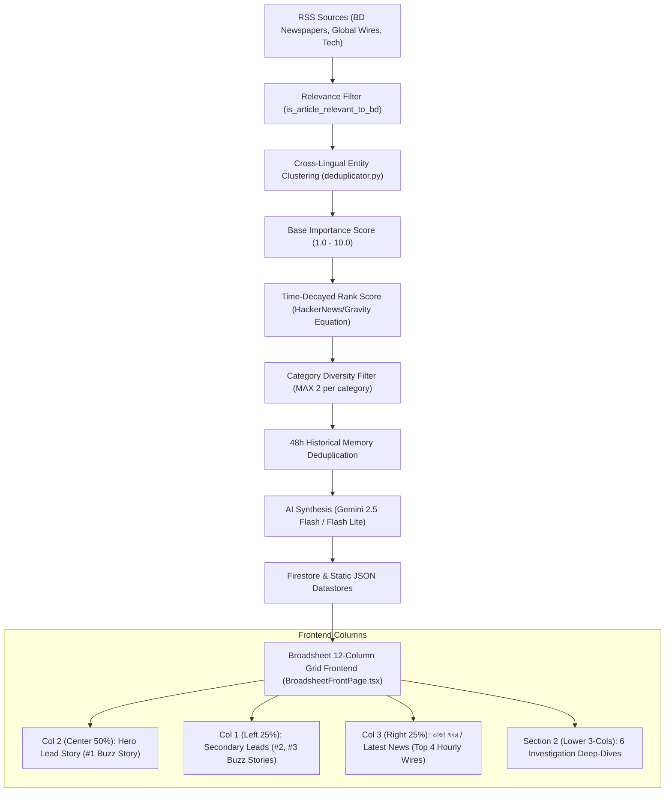

# Dorpon Daily: Ranking, Scoring & Layout Architecture Guide

This guide explains in detail:
1. **How each column on the frontpage broadsheet is selected and filled.**
2. **How the ranking and scoring algorithms calculate importance, freshness decay, and section quotas.**

---

## 1. High-Level Pipeline Architecture



---

## 2. Frontpage Broadsheet Layout: How Each Column is Filled

The frontpage is implemented in [`BroadsheetFrontPage.tsx`](../web/src/components/BroadsheetFrontPage.tsx) as a classic **12-column digital broadsheet grid**.

### Story Allocation Logic

```typescript
// BroadsheetFrontPage.tsx line 118-138
const heroStory = buzzStories[0] || hourlyWires[0] || null;
const leftStories = buzzStories.slice(1, 3);
const wireDeskStories = hourlyWires.length >= 4 
  ? hourlyWires.slice(0, 4) 
  : (hourlyWires.length > 0 ? [...hourlyWires, ...buzzStories.slice(3, 3 + (4 - hourlyWires.length))] : buzzStories.slice(3, 7));

const lowerStories = (() => {
  const usedIds = new Set<string>();
  if (heroStory) usedIds.add(heroStory.story_id);
  leftStories.forEach(s => usedIds.add(s.story_id));

  const pool = [
    ...currentAffairs.filter(s => !usedIds.has(s.story_id)),
    ...buzzStories.filter(s => !usedIds.has(s.story_id)),
    ...hourlyWires.filter(s => !usedIds.has(s.story_id))
  ];

  return pool.slice(0, 6);
})();
```

### Column Specifications

| Column Section | Grid Span | Data Source | Content Details | Visual Hierarchy |
| :--- | :--- | :--- | :--- | :--- |
| **Column 2: Center Hero Dossier** | `md:col-span-6` (50% width) | `buzzStories[0]` | The single highest-ranked story in the latest publishing cycle. | Large masthead headline (34px), full documentary photograph, Category pill, Relative timestamp, 3 Key Takeaways (`❖`), Core Story summary, and direct source link. |
| **Column 1: Left Briefings** | `md:col-span-3` (25% width) | `buzzStories[1]` and `buzzStories[2]` | Stories #2 and #3 from the ranked `buzzStories` feed. | Stacked layout of 2 stories. Story #2 includes a grayscale thumbnail photograph. Each story features 3 bullet takeaways and a 3-line core story excerpt. |
| **Column 3: Right Wire Desk ("তাজা খবর")** | `md:col-span-3` (25% width) | `hourlyWires[0..3]` (fallback to `buzzStories[3..6]`) | 4 rapid, high-velocity wire updates from `hourly_buzz`. | Numbered badges (`01`, `02`, `03`, `04`), category tags, 1 key takeaway summary per wire, and verified publisher chips. |
| **Section 2: Lower Investigations Grid** | 3 equal columns (`md:col-span-4` each $\times$ 2 rows = 6 stories) | `lowerStories[0..5]` | 6 deep-dive policy, international, and governance stories. Deduped to exclude Hero & Left stories. | Balanced 2-row grid. Highlights high-yield policy developments, economic trends, and verified primary source tags. |

---

## 3. The Backend Ranking & Scoring Algorithms

All scoring and ranking rules are defined in [`pipeline/processing/scoring.py`](../pipeline/processing/scoring.py) and applied in [`pipeline/processing/deduplicator.py`](../pipeline/processing/deduplicator.py) and [`pipeline/run_pipeline.py`](../pipeline/run_pipeline.py).

### Step 1: Relevance Gatekeeping (`is_article_relevant_to_bd`)
Filters out non-essential international fluff before any scoring occurs:
* **Rule A**: Must be from a verified Bangladesh media house (e.g. *Prothom Alo*, *The Daily Star*, *The Business Standard*, *Dhaka Tribune*, etc.), **OR**
* **Rule B**: Must mention Bangladesh geopolitical entities, leaders, or state organs, **OR**
* **Rule C**: Must cover high-impact global developments (IMF, World Bank, UN, US Election, Middle East conflict, global oil/inflation), **OR**
* **Rule D**: Must cover breakthrough tech (Generative AI, OpenAI, semiconductors, cybersecurity).
* Any story failing all 4 is rejected immediately.

### Step 2: Base Importance Score (`compute_base_importance`)
Every event cluster receives a raw importance score ranging from **1.0 to 10.0** (baseline starts at `2.0`):

| Institutional Category | Keywords / Entities | Score Boost |
| :--- | :--- | :--- |
| **Constitutional & Executive Governance** | *Supreme Court, Cabinet, Chief Adviser, Ordinance, Election Commission, Advisory Council* | **+3.5** |
| **Macroeconomics & Financial System** | *Bangladesh Bank, Repo Rate, Inflation, Forex Reserves, National Budget, NBR, IMF, World Bank* | **+3.0** |
| **National Politics & Anti-Corruption** | *Party Leadership, Resignations, Remittance, Refugee Affairs, Arrests, High-profile trials* | **+2.0** |
| **Bilateral Treaties & Geopolitics** | *Treaties, Bilateral Summits, Foreign Ministry, UN engagements* | **+2.0** |

#### Multi-Source Corroboration Multiplier
If multiple independent newsrooms report on the same event simultaneously, it indicates breaking or major national importance:
$$\text{Corroboration Factor} = 1.0 + \min(0.5, (\text{ClusterSize} - 1) \times 0.25)$$
* 1 outlet: $1.0\times$
* 2 outlets: $1.25\times$
* 3+ outlets: $1.50\times$ (maximum cap)

#### Proximity Multiplier
* Domestic Bangladesh context / Bangladeshi outlets: $\times 1.20$ boost.
* Pure international news (unless verified high-impact): $\times 0.85$ damping.

$$\text{BaseImportance} = \min\Big(10.0, \; \max(1.0, \; (\text{Base} + \sum \text{Boosts}) \times \text{Corroboration} \times \text{Proximity})\Big)$$

---

### Step 3: Time Decay Formula (`compute_time_decayed_score`)

To ensure breaking news leads without allowing stale high-importance stories to dominate indefinitely, the pipeline uses a power-law gravity decay formula:

$$\text{RankScore} = \frac{\text{BaseImportance}}{(\text{AgeInHours} + 2.0)^\gamma}$$

Where:
* $\text{AgeInHours} = \frac{\text{Now} - \text{PublishedAt}}{3600}$
* $\gamma = 1.3$ (the gravity coefficient)
* The offset $+2.0$ prevents division by zero and stabilizes fresh news during the first 30 minutes.

#### How the Decay Behaves:
1. **Fresh Breaking News ($0-1$ hour old)**:
   * A story with $\text{BaseImportance} = 8.0$ at age 0h:
     $$\text{RankScore} = \frac{8.0}{(0 + 2.0)^{1.3}} = \frac{8.0}{2.462} \approx 3.25$$
2. **Old Story ($24$ hours old)**:
   * Even an exceptional story with $\text{BaseImportance} = 9.0$:
     $$\text{RankScore} = \frac{9.0}{(24 + 2.0)^{1.3}} = \frac{9.0}{69.17} \approx 0.13$$
3. **Outcome**:
   * A fresh, moderately important update (importance 4.0, age 10 min $\rightarrow$ score $\approx 1.50$) will naturally rank above yesterday's 9.0 story (score $0.13$).
   * A major breaking event (importance 9.0, age 2h $\rightarrow$ score $1.73$) still holds the lead over a trivial fresh story (importance 2.0 $\rightarrow$ score $0.75$).

---

### Step 4: Category Diversity Balancing Quota

To prevent any single breaking topic (e.g., 5 articles on the same political rally) from crowding out other sections:
* `MAX_PER_CATEGORY = 2`: In each publishing cycle, at most 2 stories can originate from the same primary topic (Politics, Economy, International, Tech, Climate, Society, Sports).
* **Pass 1**: The algorithm selects the highest ranked story across distinct categories to populate every section.
* **Pass 2**: Any remaining open quota slots are filled with the next highest-scoring candidates.

---

### Step 5: 48-Hour Cross-Run Memory Deduplication

Before generating an article, the pipeline checks against the last 100 published stories in Firestore:
1. **Canonical Entity Overlap**: Compares named entity sets (e.g., specific politician name + foreign city).
2. **Title Jaccard Similarity**: Calculates token overlap on cleaned Bengali and English titles (excludes common stopwords).
3. **Outcome**: If a story is already covered, it is not regenerated as a duplicate; instead, the existing story in Firestore is enriched with any new source links.

---

## 4. Current Affairs Editorial Path vs. AI Automated Pipeline

| Feature | Hourly Buzz & Top Stories | Current Affairs Editorial Dossiers |
| :--- | :--- | :--- |
| **Curation Mode** | Automated AI Pipeline (`run_pipeline.py`) | **Human-in-the-Loop Editorial Oversight** |
| **Trigger** | Scheduled GitHub Actions Cron (Hourly) | Editor Studio (`/api/editor/publish`) |
| **Output Destination** | `daily_buzz` & `hourly_buzz` collections | `current_affairs_published` & `bcs_pro_published` |
| **Frontend Tab** | **Synthetic Brief** (`top_stories`) | **কারেন্ট অ্যাফেয়ার্স** (`current_affairs`) |
| **Content Depth** | 60-second executive summaries & takeaways | Full multi-tier analytical dossiers with empirical statistics, question breakdowns, and policy way forwards |
